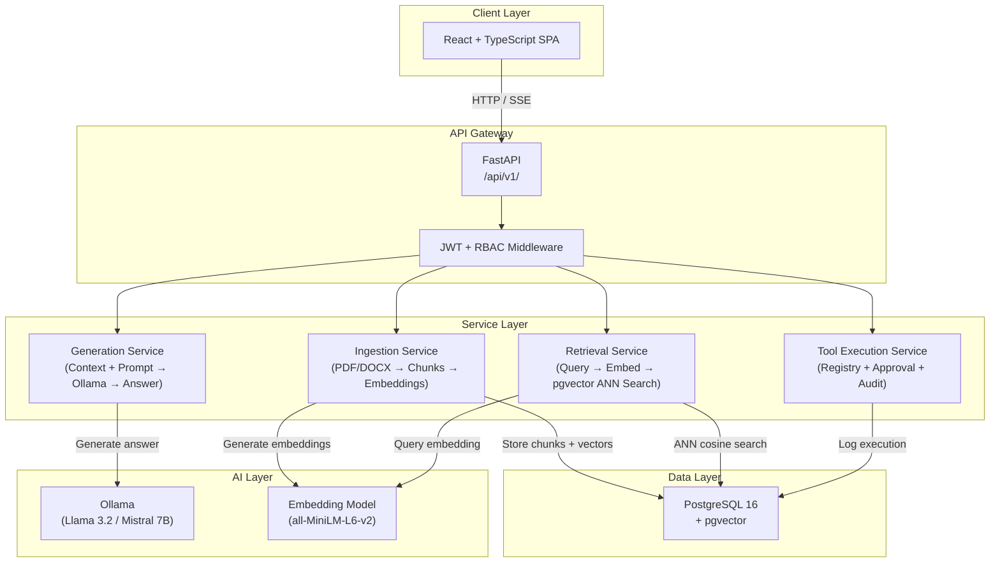
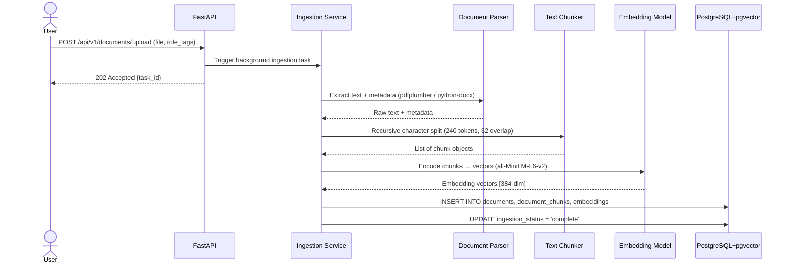
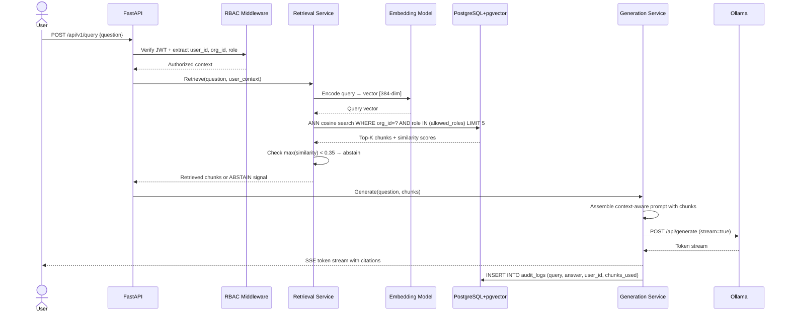
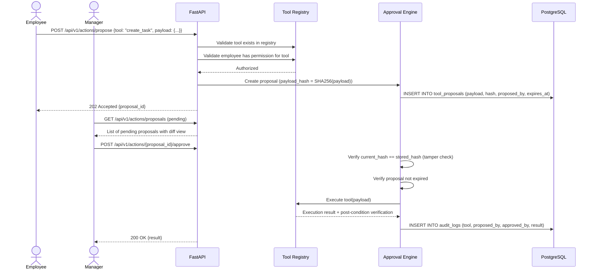
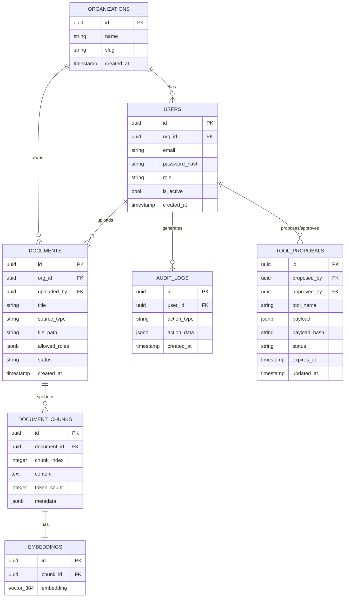
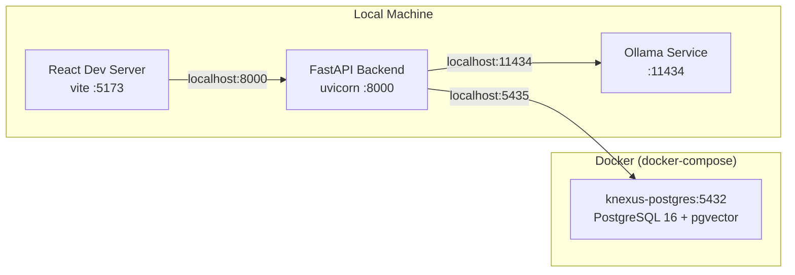

# Architecture Document

> **Implementation status - 18 October 2026:** This document describes the target design and acceptance criteria. Only the backend scaffold, dependency health route, and PostgreSQL/pgvector bootstrap are implemented. See [REPOSITORY_REVIEW.md](REPOSITORY_REVIEW.md) for current behavior and known gaps. Code examples, proposed directories, tests, and migrations below are not evidence of completed work.

## KNEXUS: Knowledge Network for EXploration and Unified Services
**Version:** 1.0 | **Status:** Active | **Last Updated:** October 2026

---

## 1. System Overview

KNEXUS is a multi-layered AI knowledge platform. Its architecture is designed around three core principles:

1. **Privacy-first:** All AI inference runs locally via Ollama — document content is intended to stay within the configured local deployment. Initial package/model downloads require network access; provider URLs and network exposure must be reviewed.
2. **Security-by-design:** RBAC and multi-tenancy are enforced at the database layer, not the UI.
3. **Separation of concerns:** Each subsystem (Ingestion, Retrieval, Generation, Governance) is independently testable and replaceable.

---

## Current runtime

The implemented path is client -> FastAPI -> health handler -> PostgreSQL probes and Ollama `/api/tags`. CORS and cached settings are configured; no JWT middleware, RAG services, model loading, or schema creation runs on startup. Startup logs a message and shutdown disposes the database engine. Compose starts PostgreSQL only.

The diagrams and expanded directory tree below are **proposed**. Actual tracked source files are listed in [REPOSITORY_REVIEW.md](REPOSITORY_REVIEW.md).

## 2. High-Level Architecture (target)



---

## 3. Component Architecture

### 3.1 Document Ingestion Pipeline



### 3.2 RAG Query Pipeline



### 3.3 Tool Execution & Approval Workflow



---

## 4. Database Architecture



---

## 5. Proposed Directory Structure

```text
KNEXUS/
├── backend/
│   ├── app/
│   │   ├── main.py                   # FastAPI application entry point
│   │   ├── api/
│   │   │   └── v1/
│   │   │       ├── router.py         # Route aggregator
│   │   │       └── endpoints/
│   │   │           ├── health.py
│   │   │           ├── auth.py       # Login, refresh, logout
│   │   │           ├── documents.py  # Upload, list, delete
│   │   │           ├── query.py      # RAG query endpoint
│   │   │           └── actions.py    # Tool proposals & approvals
│   │   ├── core/
│   │   │   ├── config.py             # Pydantic settings
│   │   │   ├── database.py           # Async SQLAlchemy engine
│   │   │   └── security.py           # JWT, bcrypt utilities
│   │   ├── models/
│   │   │   ├── user.py
│   │   │   ├── document.py
│   │   │   ├── chunk.py
│   │   │   ├── embedding.py
│   │   │   ├── audit_log.py
│   │   │   └── tool_proposal.py
│   │   ├── schemas/                  # Pydantic request/response schemas
│   │   ├── services/
│   │   │   ├── ingestion/
│   │   │   │   ├── parser.py         # PDF/DOCX text extraction
│   │   │   │   ├── chunker.py        # Recursive character splitter
│   │   │   │   └── embedder.py       # Embedding generation
│   │   │   ├── retrieval/
│   │   │   │   ├── searcher.py       # pgvector ANN search
│   │   │   │   └── reranker.py       # Optional: cross-encoder rerank
│   │   │   ├── generation/
│   │   │   │   ├── ollama_client.py  # Ollama API wrapper
│   │   │   │   ├── prompt_builder.py # Context assembly + prompt templates
│   │   │   │   └── citation.py       # Citation extraction & formatting
│   │   │   └── tools/
│   │   │       ├── registry.py       # Tool registry
│   │   │       └── approval.py       # Approval workflow engine
│   │   ├── middleware/
│   │   │   └── rbac.py               # RBAC FastAPI dependency
│   │   └── utils/
│   │       └── logging.py
│   ├── alembic/                      # DB migration scripts
│   ├── tests/
│   │   ├── unit/
│   │   ├── integration/
│   │   └── evaluation/               # RAG benchmark harness
│   └── requirements.txt
│
├── frontend/
│   ├── src/
│   │   ├── components/               # Reusable UI components
│   │   ├── pages/                    # Login, Chat, Admin, Approvals
│   │   ├── hooks/                    # Custom React hooks
│   │   ├── services/                 # API client functions
│   │   ├── context/                  # Auth context, role context
│   │   └── types/                    # TypeScript type definitions
│   ├── public/
│   ├── index.html
│   ├── vite.config.ts
│   └── package.json
│
├── data/
│   ├── samples/                      # Curated dataset samples
│   ├── evaluation/                   # 500-question QA benchmark
│   └── fixtures/                     # RBAC security test fixtures
│
├── docker/
│   └── init.sql                      # pgvector extension init
│
├── docs/                             # ← All documentation lives here
├── .env.example
├── .gitignore
├── docker-compose.yml
├── CONTRIBUTING.md
└── README.md
```

---

## 6. Planned Integration Points

### 6.1 Frontend ↔ Backend

| Flow | Method | Auth |
|---|---|---|
| Login | `POST /api/v1/auth/login` | None |
| Upload document | `POST /api/v1/documents/upload` | JWT + OrgAdmin role |
| Ask a question | `POST /api/v1/query` | JWT + any role |
| Stream answer | `GET /api/v1/query/stream/{session_id}` | JWT (SSE) |
| Propose action | `POST /api/v1/actions/propose` | JWT + Employee role |
| List pending approvals | `GET /api/v1/actions/proposals` | JWT + Manager role |
| Approve action | `POST /api/v1/actions/{id}/approve` | JWT + Manager role |

### 6.2 Backend ↔ Ollama

- Communication via HTTP REST (`httpx` async client)
- Endpoint: `POST http://localhost:11434/api/generate`
- Streaming: `stream: true` with chunk-by-chunk SSE relay
- Model config set via `OLLAMA_MODEL` environment variable

### 6.3 Backend ↔ Embedding Model

- Sentence Transformers loaded once at application startup
- Cached in memory for the process lifetime
- Alternatively: use Ollama's `/api/embeddings` endpoint for fully local operation

---

## 7. Target Deployment Architecture (Local/Development)



---

*KNEXUS Architecture v1.0 | MJCET CSE (AI&ML) | Team 3 | 2026–2027*
