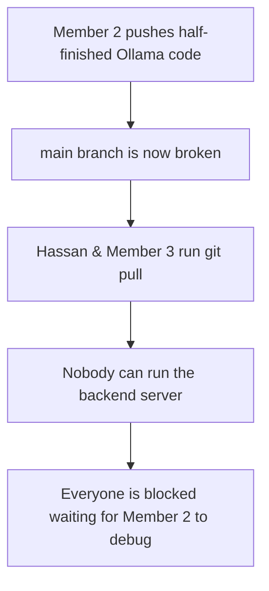
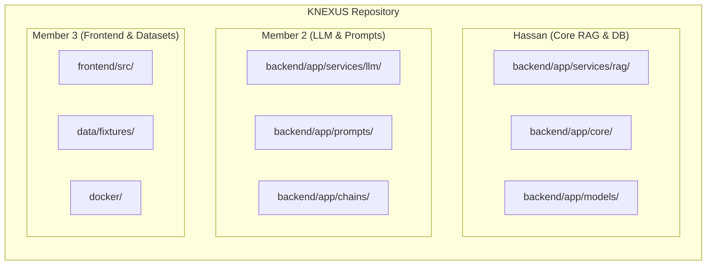
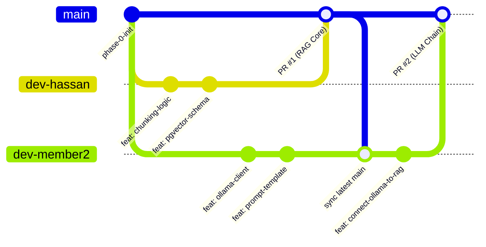

# KNEXUS — Team Git Branching & Collaboration Guide

> [!NOTE]
> **Purpose:** Practical, friction-free guide for the 3-member KNEXUS engineering team. Designed to demystify Git branching, prevent code overwrites, and make team collaboration fast and reliable.

---

## 1. Why Not Just Commit Directly to `main`?

A common question in student engineering teams is: *"Why can't we all just push directly to `main` and coordinate in WhatsApp/Discord?"*

Here is what happens in practice when 3 developers push directly to `main`:



### Direct `main` vs. Branching Comparison

| Scenario | Direct Push to `main` | Branching Model (`dev-<member>`) |
|---|---|---|
| **Code in progress** | You cannot push without risking breaking your teammates' local setups. | You can push half-finished code anytime as a backup without affecting anyone. |
| **Simultaneous edits** | Git rejects `git push` until you pull; pulling causes instant merge conflicts inside your working tree. | Zero conflicts during active development. You merge only when work is verified. |
| **Viva & Evaluation** | Commit history looks messy (`fix`, `test`, `working now`). Evaluators cannot see individual contributions. | Clean PR history showcasing distinct features, architecture ownership, and teamwork. |
| **Experimentation** | Trying a new library or refactoring is risky because it directly alters shared code. | Completely safe. If an experiment fails, simply delete or reset your branch. |

---

## 2. The Conflict Prevention Architecture

> [!TIP]
> **Git only generates a merge conflict when two people edit the exact same lines of the exact same file at the same time.**

Because the KNEXUS project plan isolates responsibilities into distinct modules, file collisions are naturally prevented:



Because each member operates in separate subdirectories, Git performs **automatic fast-forward merges with zero conflicts 99% of the time**.

---

## 3. Recommended Strategy: The 3-Member Branch Workflow

Rather than creating dozens of temporary feature branches that require complex bookkeeping, the team uses **persistent member branches**:



- **`main`**: The "Demo / Release" branch. Always stable, always tested, never committed to directly.
- **`dev-hassan`**: Hassan's active development branch (RAG core, database, ingestion).
- **`dev-member2`**: Member 2's active development branch (Ollama, prompts, evaluation).
- **`dev-member3`**: Member 3's active development branch (Frontend UI, datasets, ETL).

---

## 4. The 4 Essential Daily Routines

Here are the exact commands each teammate will use:

### Routine 1: Initial Branch Setup *(Run once after cloning)*
```bash
# Clone the repository
git clone https://github.com/Hassan092-prog/KNEXUS.git
cd KNEXUS

# Create your personal working branch from main
git checkout -b dev-<yourname>

# Push your branch to GitHub
git push -u origin dev-<yourname>
```

---

### Routine 2: Daily Development *(Save your progress)*
```bash
# Verify you are on your personal branch
git branch

# Stage and commit your changes
git add .
git commit -m "feat(rag): implement recursive character chunker"

# Push to your remote branch on GitHub
git push
```

> [!NOTE]
> You can commit and push to your branch as frequently as you want. It never affects anyone else's local code.

---

### Routine 3: Syncing Updates from `main` *(Start of every day)*
Before beginning new code, pull in features merged by your teammates:

```bash
# Make sure your working branch is clean (commit or stash changes)
git checkout dev-<yourname>

# Pull latest stable code from main into your branch
git pull origin main
```
Git will automatically incorporate all merged updates into your branch.

---

### Routine 4: Merging Completed Work into `main` *(Milestone completion)*
When a feature is finished and tested locally:

1. Push your latest commits:
   ```bash
   git push origin dev-<yourname>
   ```
2. Open [GitHub KNEXUS Pull Requests](https://github.com/Hassan092-prog/KNEXUS/pulls).
3. Click **New Pull Request**:
   - **Base:** `main`
   - **Compare:** `dev-<yourname>`
4. Add a short summary of changes.
5. The team lead reviews and clicks **Confirm Merge**.

---

## 5. Golden Rules for Frictionless Collaboration

1. **Never commit secrets:** Never commit `.env` or API credentials. `.gitignore` is already set up to protect against this.
2. **Never commit virtual environments or node_modules:** Always let each member install locally via `requirements.txt` or `package.json`.
3. **Communicate before touching shared files:** If you need to edit a core shared file like `backend/app/main.py` or `docker-compose.yml`, give the team a quick heads-up so everyone is aligned.
4. **If Git ever throws a conflict:**
   - Don't panic.
   - Run `git status` to see which file has the conflict.
   - Open that file in VS Code / IDE. Look for the `<<<<<<< HEAD` markers.
   - Choose which version to keep, save the file, and run:
     ```bash
     git add <filename>
     git commit -m "chore: resolve merge conflict"
     git push
     ```
